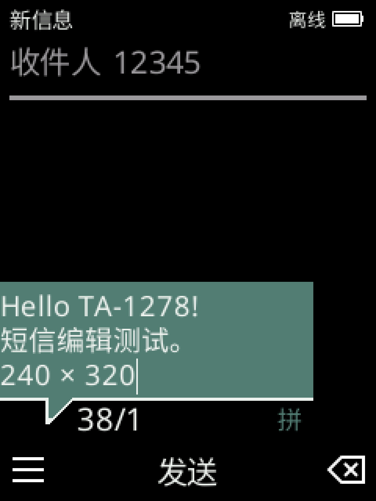
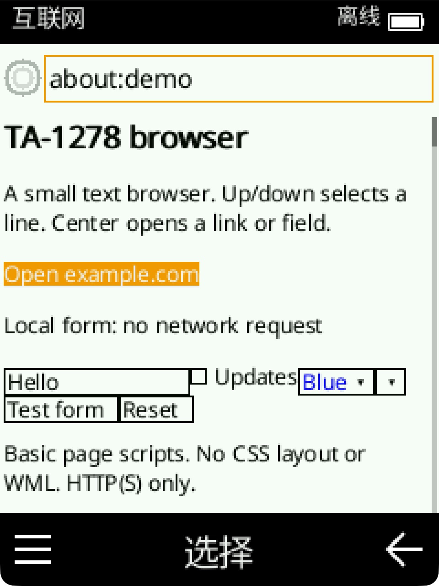
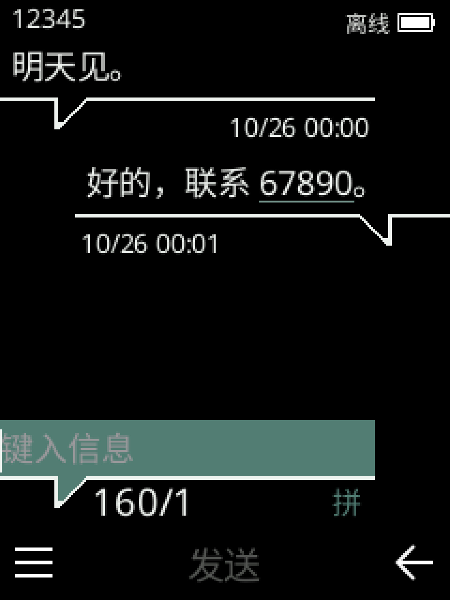
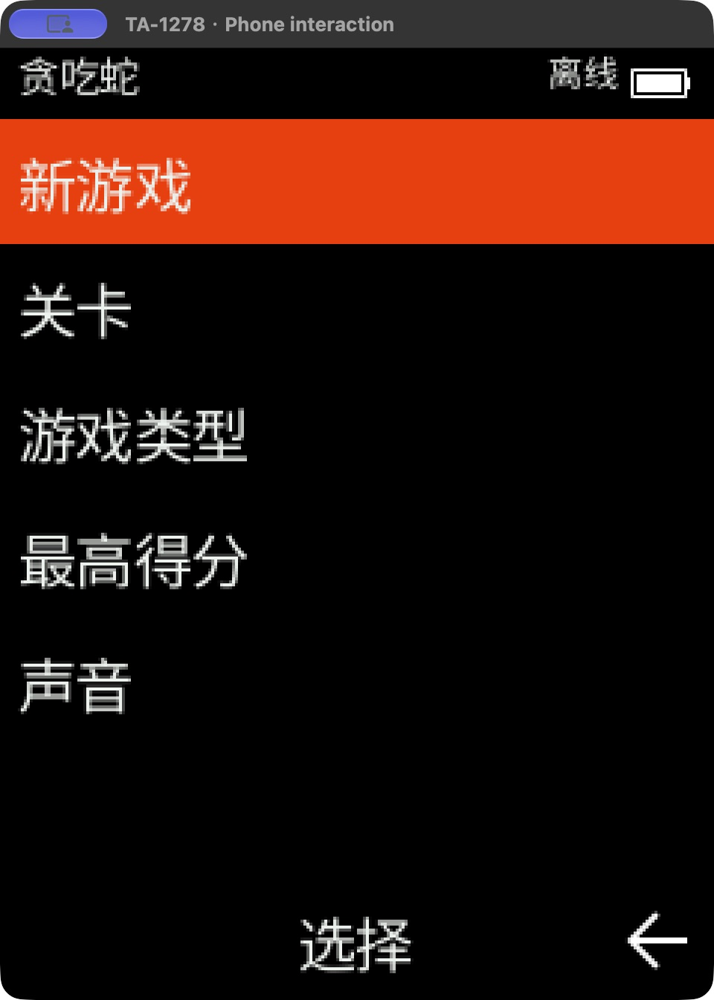
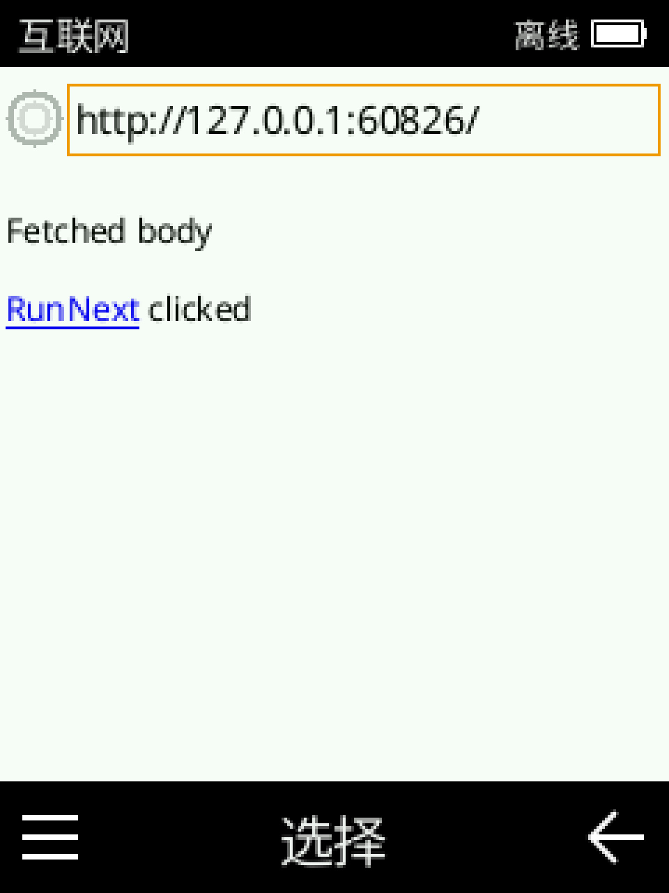

# Nokia TA-1278

[English](README.md)

用户态的功能机交互运行库与桌面程序，以 Nokia TA-1278 的使用体验为基础。

## 运行截图

桌面程序的实际运行窗口。短信为模拟内容，浏览器展示本地演示页面。

| 短信 | 贪吃蛇 | 浏览器 |
| --- | --- | --- |
| <br>短信编辑 | <br>运行画面 | <br>文字与表单 |
| <br>短信会话 | <br>菜单 | <br>JavaScript 与事件 |

## 运行

面向 macOS（arm64/Intel）、Windows x64 和 Linux x64。[下载](https://github.com/shiftz300/ta-1278/releases/latest) · [平台限制与自动发布](docs/release.md)。构建需要 Rust、图形驱动和对应的 C/C++ 工具链；macOS 还需要 Apple Command Line Tools。

```sh
cargo run --release --locked -p phone-desktop
```

macOS 打包：`sh scripts/package-macos.sh`，结果在 `target/TA1278.app`。

方向键导航，Enter 确认，F1/F2 对应左右软键。鼠标左键、右键、中键分别对应左软键、右软键和确认键。数字键使用内部输入法，# 切换模式；系统输入法关闭。

## 功能

- 信息：编辑、会话、草稿、接收记录和本地发送队列；预留后端接口，不发送真实短信。
- 浏览器：HTTP(S) 文本页面、基础 JavaScript/DOM、链接、表单和 GET 提交；不支持完整 CSS、复杂单页应用、POST 或网页图片。[脚本能力与安全边界](docs/javascript.md)。
- 音乐：播放本地 MP3/WAV/MIDI（支持 `.mid`、`.MID` 和 `.midi`），支持播放列表、重复、随机和断点位置。
- 通讯录、日历、闹钟、文件、计算器、计时器、秒表和贪吃蛇。
- 电话：拨号、通讯录/短信号码入口和本地拨号记录；尚未连接真实通话后端。

首次启动选择一个文件夹作为“手机存储”，直接访问文件，不使用 VFS 或导入副本。可用 `--storage-dir PATH` 指定路径，或 `--read-only-storage` 禁止写入。私人配置和消息另存于用户数据目录。

[统一配置](docs/config.md)可关闭可选应用；主屏、信息、通讯录、设置和文件保留，其他已实现应用默认开启。

[界面核对](docs/review.md) · [完整使用验收与复跑方法](docs/acceptance.md)

## 嵌入

`phone_runtime` 不要求创建窗口。宿主提供按键、时间、消息服务和持久化，取得 240×320 RGBA 帧。

```sh
cargo run -p phone-desktop --no-default-features --locked --example embed -- /tmp/ta1278-embed
```

[接口与限制](docs/runtime.md) · [架构](docs/architecture.md) · [服务接口](docs/services.md) · [输入法](docs/input-engine.md) · [存储](docs/storage.md) · [当前范围](docs/remaining-work.md)

## 仓库范围

本仓库只保留程序、运行资源和回归测试。固件镜像、采集工具、反汇编、实机截图和分析报告已迁至独立研究归档；构建和测试不依赖研究目录或实机。

运行需要的原机字体、图标、铃声和 T9 代码及词库继续保留，来源与权利说明见 [资源](assets/README.md)及[第三方说明](THIRD_PARTY_NOTICES.md)。这里不声称完成了原机整个系统的逆向。
