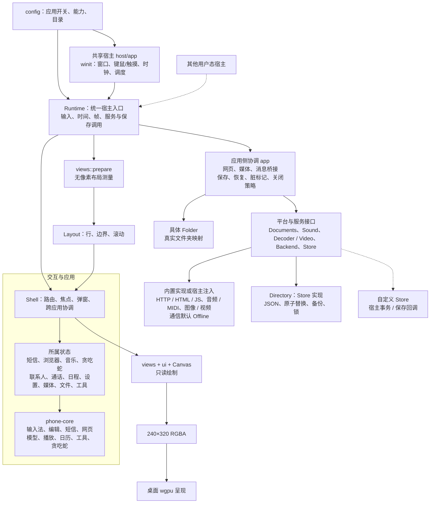
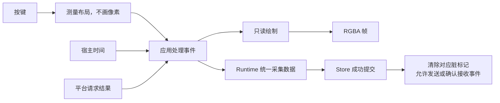

# 功能与架构

核对基线：`0.2.3` / `89ddcee`，2026-10-27；下图包含本地未提交的应用侧合并、Shell 命名与模块边界调整。当前是用户态交互运行库与桌面宿主。Cargo 仍只有 `phone-core` 和 `phone-desktop` 两个包；模块按职责拆分，没有增加依赖或插件框架。

连线表示已有调用或数据流，虚线表示可选接入，不等同于 Cargo 依赖。网页、音频、视频接口不接收 `Shell`；应用侧 `media` 保留必要的跨应用协调；消息服务只接收消息状态，视觉桥接只接收媒体状态与上下文。文件能力传入具体 `Folder`，不引入 VFS。

## 状态归属

| 所属状态 | 内容 |
|---|---|
| `messaging` | 邮箱、编辑器、会话、发送事务、未保存标记 |
| `browsing` | 文档模型、页面类型、书签/历史、请求与保存标记 |
| `playback` | 播放模型、路径索引、播放列表、刷新与恢复状态 |
| `gaming` | 贪吃蛇模型、菜单、关卡预览与成绩 |
| `contacts` / `calls` | 通讯录、分组、独立页面/草稿/收件人选择；拨号/记录 |
| `organizer` | 日历、闹钟、提醒；联系人复用 UI 控件，但不再共用页面、草稿或返回焦点 |
| `settings` | 设置值、设置页面、主题预览 |
| `media` / `files` / `tools` | 媒体选择与图像缓存、文件操作、工具 |

旧 `organizer.json` 仍包含联系人、播放列表、通话记录等，**但它只是兼容序列化 DTO**，不再是运行中的跨应用状态容器。`Shell::records/apply_records` 在持久化边界组装/分配数据。

## 输入、绘制与保存

`Runtime::render` 不修改应用状态，也不推进时间。布局结果只在输入测量阶段应用，光标不依赖上一次绘制是否发生。`views::render` 仅作为内部画面测试兼容入口；生产绘制通过只读的 `views::paint`。

## 平台接口

- `Platform` 绑定一个 `Runtime::instance()`，恢复出的新实例拒绝旧适配器。
- `Documents` 收发不透明 `Request` 与解析后的 `Page`。Runtime 校验实例和请求代次，拒绝过期结果。HTTP/JS 的限制保持不变。
- `Devices` 在首次平台轮询时显式移交目录、`Sound` 和 `Decoder`；运行库内的应用桥接处理状态，平台只接收路径、像素、视频命令或播放模型。
- `Sound` 接收不可变 `Playback` 请求并返回 `PlaybackStatus`（时长、位置、结束、停止、错误）；应用侧更新播放模型并决定重复和队列，不允许适配器直接修改模型。`Decoder::audio_duration` 也负责曲库扫描的时长读取。`Video` 暴露帧、命令和生命周期；系统进程细节留在具体实现。
- Native 是上述接口的内置实现。macOS 系统媒体助手仍只有 macOS 提供，Windows/Linux 媒体限制未改变。

`Devices` 是一次性绑定，换宿主/恢复数据时应创建新 Runtime 和适配器。运行库拥有已移交设备的生命周期；仅丢弃 Native 网页适配器不会销毁已移交的媒体对象。

## 统一持久化

`persistence::Store` 以有名称和大小上限的 `Record` 为单位读取/原子写入。`Runtime` 的公开保存入口委托内部应用侧 `app` 模块组织数据采集、校验、读取恢复、脏标记确认和关闭策略。窗口不再序列化应用，媒体对象也不保存播放器设置。

- `load_profile / flush` 保留原有分文件 JSON 和五秒周期保存。首个失败暂停后续写入；已成功的分项不会被标记为失败。短信文件与服务游标仍在同一记录内。
- `save_to / restore_from` 通过同一 Store 接口存取完整用户数据快照。`save(callback) / restore(bytes)` 保留兼容入口，使用同一状态采集与校验。
- `Directory::open` 持有单实例锁；`Directory::new` 供已经持有事务/锁的调用方使用。损坏文件、上限检查、`.bak` 与原子替换继续保留。
- `Resume::WallClock` 保留桌面的离线计时追赶；`Resume::Paused` 保留嵌入宿主暂停语义。两种策略显式选择，共用恢复代码。
- 保存失败不关闭编辑器；窗口关闭复用 `Runtime::close`。未提交候选词、进行中的文件修改仍按原有规则处理。

物理存储布局保留两种是为了兼容，并非两套应用保存逻辑。整包快照仍不是完整进程快照，不恢复全部临时页面/表单、活动网页请求或解码器。

## 保留的边界

- Runtime 与宿主仍在同一个 Cargo 包；此轮没有继续拆 crate。
- `Shell` 保留统一路由、焦点、弹窗和跨应用行为协调；并非应用插件系统。
- 文件服务明确映射宿主文件夹，不是安全沙箱或可替换虚拟磁盘。
- JS 仍在进程内受限执行，不是独立进程沙箱。
- 电话是本地拨号/记录；真实通信后端、FM、录音与手电筒硬件未实现。
- 配置开关控制运行行为，不能自动裁剪 Cargo 依赖。

## 源码入口

| 责任 | 入口 |
|---|---|
| Runtime 协调与只读帧输出 | `crates/phone-desktop/src/runtime.rs` |
| 应用侧协调状态、网页与消息桥接 | `runtime/app.rs`、`runtime/app/bridge.rs` |
| 应用侧记录持久化、快照与关闭 | `runtime/app/persist.rs`、`runtime/app/state.rs` |
| 存储机制与公共平台入口 | `persistence.rs`、`platform.rs`（重导出同一 Store） |
| 宿主接口与系统解码 | `platform.rs`、`platform/visual.rs` |
| 各应用状态 | `shell/*/state.rs`、`shell/contacts.rs`、`shell/calls.rs`、`shell/organizer.rs` |
| 只读页面和共享测量 | `views/*`、`ui/layout.rs`、`canvas.rs` |
| 桌面/Android 窗口 | `desktop.rs`、`android.rs`、`host/app.rs`、`host/input.rs`、`host/keypad/`、`gpu.rs` |
| 状态算法 | `crates/phone-core/src/*` |

接口和保存语义详见 [Runtime](runtime.md)、[服务](services.md)、[恢复](persistence.md)。

## 本轮架构复核

内部类型和模块已从 `Phone` / `phone` 更名为 `Shell` / `shell`。它表示路由、焦点、共享编辑与跨应用协调，不是操作系统或通信后端。Cargo 包名、公开 Runtime 入口、用户配置及存储格式保留。

| 已完成 | 当前边界 |
|---|---|
| 弹窗与菜单复制精简 | 绘制借用 Overlay；固定菜单使用静态 Item 声明，不再反复构造字符串数组 |
| 通用弹窗及联系人菜单 | 同一份 typed action、文字、可用性和标记用于绘制与激活；保留符号网格、浏览器和软键差异 |
| 联系人控制状态独立 | 自有 Page、draft、editing、selected 和 pick_recipient；本地字段输入、校验与保存只访问 contacts::State |
| 消息服务访问范围 | Services 只处理消息状态；prepare/receive 返回结果，应用侧负责会话焦点和预警展示；持久化确认顺序保持 |
| 音频结果边界 | Sound 无可变 Music 引用；应用侧处理播放报告、队列/重复、错误和位置；曲库扫描使用注入的 Decoder |
| 视觉桥接访问范围 | VisualMedia 不接收 Shell，只处理 media::State、输入上下文并返回暂停音乐、关闭和提示等明确结果 |

仍有意保留两个层次：Shell 处理导航与跨应用流程，Runtime/app 处理宿主服务和保存协调。应用侧的 Media 聚合器仍能访问 Shell，用于铃声、闹钟、文件和播放器之间的实际协调；没有把所有 UI 事件改成消息，也没有引入另一套控制器框架。

以下事项仍按需求决定，不视作本轮未完成项：测量与绘制共用布局路径，暂不添加通用缓存；原生 I/O 依赖仍非可选，轻量嵌入构建需要另行设置编译开关；不增加 crate 或应用插件系统。

### 建议保留

- `Runtime` 作为唯一宿主入口，`Shell` 作为路由与跨应用协调者。集中协调本身不是需要消灭的耦合。
- 共享 `ui` 控件与既有菜单声明，不再引入 MVC、插件注册或另一套应用框架。
- 分项 JSON 与快照使用同一个 Store，但保留各自的保存时机与恢复语义。记录顺序、首错中止、短信持久化后才能发送/确认接收都属于现有行为，不能为了少写几行改成无序批量提交。
- `organizer.json` 的兼容 DTO 目前仍在 organizer 模块，运行时数据已分属各应用。可以在后续移动 DTO/校验的位置，暂不更换文件格式。
- 真实文件夹映射、240×320 软件绘制加 wgpu 呈现、两个 Cargo 包的现有划分。

## 应用侧协调层合并

原来并列的桥接与保存策略合并为 `runtime/app`：Runtime 只持有一个 App 协调状态，不再分别持有 Host、Session 和 Services。网页请求、媒体绑定、消息服务、周期保存缓存归此模块管理；关闭规则和保存/恢复规则也在同一模块内。

- `app/bridge.rs`：网页请求与异步完成、媒体绑定、消息服务。
- `app/persist.rs`：应用记录保存、脏标记确认、失败与关闭处理。
- `app/state.rs`：应用快照的采集、校验和恢复。
- 平台保留机制接口。`platform::{Store, Record, Directory}` 与旧 `persistence` 路径是同一组类型，不是两个存储实现，也不把窗口或平台适配器变成应用状态的拥有者。

这里合并的是协调归属，并非把网络、音频、存储塞进一个巨型 trait；宿主仍可单独注入 Store，以便把手机快照与宿主自身状态放进同一事务。公开 Runtime 方法、数据格式和调用顺序保持不变。
