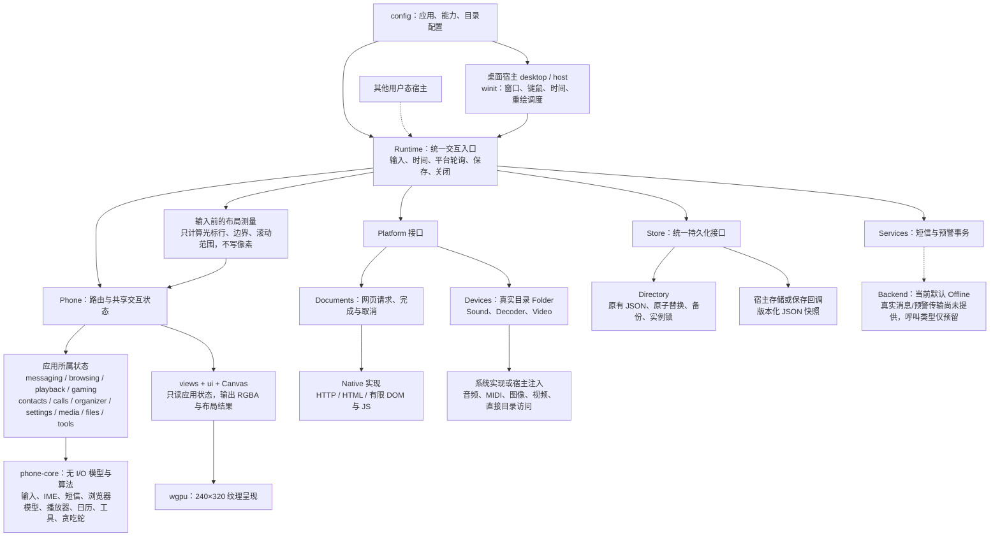
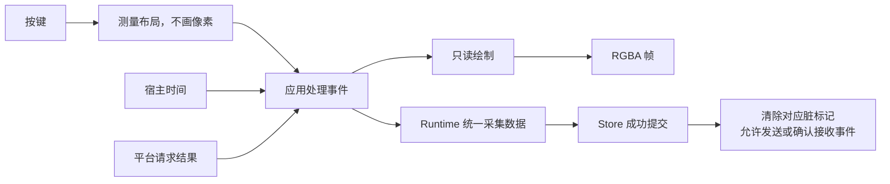

# 功能与架构

当前是用户态交互运行库与桌面宿主。Cargo 仍只有 `phone-core` 和 `phone-desktop` 两个包；模块按职责拆分，没有增加依赖或插件框架。

实线为已有调用/数据流；虚线为可选接入。网页、音频、视频适配器不能访问 `Phone`。文件能力显式传入真实目录，不引入 VFS。

## 状态归属

| 所属状态 | 内容 |
|---|---|
| `messaging` | 邮箱、编辑器、会话、发送事务、未保存标记 |
| `browsing` | 文档模型、页面类型、书签/历史、请求与保存标记 |
| `playback` | 播放模型、路径索引、播放列表、刷新与恢复状态 |
| `gaming` | 贪吃蛇模型、菜单、关卡预览与成绩 |
| `contacts` / `calls` | 通讯录、分组、联系人输入与拨号/记录 |
| `organizer` | 日历、闹钟、提醒与共享表单；通讯录继续复用已有表单行为 |
| `settings` | 设置值、设置页面、主题预览 |
| `media` / `files` / `tools` | 媒体选择与图像缓存、文件操作、工具 |

旧 `organizer.json` 仍包含联系人、播放列表、通话记录等，**但它只是兼容序列化 DTO**，不再是运行中的跨应用状态容器。`Phone::records/apply_records` 在持久化边界组装/分配数据。

## 输入、绘制与保存

`Runtime::render` 不修改应用状态，也不推进时间。布局结果只在输入测量阶段应用，光标不依赖上一次绘制是否发生。`views::render` 仅作为内部画面测试兼容入口；生产绘制通过只读的 `views::paint`。

## 平台接口

- `Platform` 绑定一个 `Runtime::instance()`，恢复出的新实例拒绝旧适配器。
- `Documents` 收发不透明 `Request` 与解析后的 `Page`。Runtime 校验实例和请求代次，拒绝过期结果。HTTP/JS 的限制保持不变。
- `Devices` 在首次平台轮询时显式移交目录、`Sound` 和 `Decoder`；运行库内的应用桥接处理状态，平台只接收路径、像素、视频命令或播放模型。
- `Sound` 同步播放时钟与核心播放器模型；不接触 UI 状态。`Video` 暴露帧、命令和生命周期；系统进程细节留在具体实现。
- Native 是上述接口的内置实现。macOS 系统媒体助手仍只有 macOS 提供，Windows/Linux 媒体限制未改变。

`Devices` 是一次性绑定，换宿主/恢复数据时应创建新 Runtime 和适配器。运行库拥有已移交设备的生命周期；仅丢弃 Native 网页适配器不会销毁已移交的媒体对象。

## 统一持久化

`persistence::Store` 以有名称和大小上限的 `Record` 为单位读取/原子写入。`Runtime` 统一拥有数据采集、校验、读取恢复、脏标记确认和关闭策略。窗口不再序列化应用，媒体对象也不保存播放器设置。

- `load_profile / flush` 保留原有分文件 JSON 和五秒周期保存。首个失败暂停后续写入；已成功的分项不会被标记为失败。短信文件与服务游标仍在同一记录内。
- `save_to / restore_from` 通过同一 Store 接口存取完整用户数据快照。`save(callback) / restore(bytes)` 保留兼容入口，使用同一状态采集与校验。
- `Directory::open` 持有单实例锁；`Directory::new` 供已经持有事务/锁的调用方使用。损坏文件、上限检查、`.bak` 与原子替换继续保留。
- `Resume::WallClock` 保留桌面的离线计时追赶；`Resume::Paused` 保留嵌入宿主暂停语义。两种策略显式选择，共用恢复代码。
- 保存失败不关闭编辑器；窗口关闭复用 `Runtime::close`。未提交候选词、进行中的文件修改仍按原有规则处理。

物理存储布局保留两种是为了兼容，并非两套应用保存逻辑。整包快照仍不是完整进程快照，不恢复全部临时页面/表单、活动网页请求或解码器。

## 保留的边界

- Runtime 与宿主仍在同一个 Cargo 包；此轮没有继续拆 crate。
- `Phone` 保留统一路由、焦点、弹窗和跨应用行为协调；并非应用插件系统。
- 文件服务明确映射宿主文件夹，不是安全沙箱或可替换虚拟磁盘。
- JS 仍在进程内受限执行，不是独立进程沙箱。
- 电话是本地拨号/记录；真实通信后端、FM、录音与手电筒硬件未实现。
- 配置开关控制运行行为，不能自动裁剪 Cargo 依赖。

## 源码入口

| 责任 | 入口 |
|---|---|
| Runtime 协调与只读帧输出 | `crates/phone-desktop/src/runtime.rs` |
| 平台桥接、关闭 | `runtime/host.rs` |
| 统一记录持久化、快照 | `runtime/persist.rs`、`runtime/state.rs`、`persistence.rs` |
| 宿主接口与系统解码 | `platform.rs`、`platform/visual.rs` |
| 各应用状态 | `phone/*/state.rs`、`phone/contacts.rs`、`phone/calls.rs`、`phone/organizer.rs` |
| 只读页面和共享测量 | `views/*`、`ui/layout.rs`、`canvas.rs` |
| 桌面窗口 | `desktop.rs`、`host/input.rs`、`gpu.rs` |
| 状态算法 | `crates/phone-core/src/*` |

接口和保存语义详见 [Runtime](runtime.md)、[服务](services.md)、[恢复](persistence.md)。
