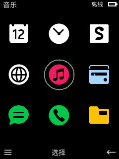
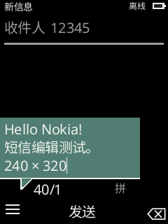

# Validation — 2026-10-25

Host: macOS arm64, Rust 1.96.0. Runtime: winit 0.30.13, wgpu 30.0.1, Apple M5 Pro / Metal. Other operating systems have not been tested.

## Automated

```sh
cargo fmt --all -- --check
cargo test --workspace --locked --offline
cargo clippy --workspace --all-targets --locked --offline -- -D warnings
cargo build --workspace --locked --offline
target/debug/phone-desktop --smoke-test /tmp/ta1278-smoke
```

The offline commands require a prior Cargo dependency fetch. The smoke run opens a real window, presents 43 home/menu/SMS/browser/music/theme, organizer, utility and game scenarios through wgpu and exits. Its PNGs are the CPU framebuffer uploaded to the GPU, not GPU readbacks. The latest run reported 44 presented frames using Metal. All 43 previews and a contact sheet are in `docs/images/`, with SHA-256 hashes. Menu, theme, SMS/recipient/prediction, browser controls, music, organizer and utility layouts were inspected. These are replica previews, not handset screenshots.

56 Rust tests pass (24 core, 32 desktop). `scripts/check-recovered-table.py` also checks all ten Latin multi-tap rows against the extracted firmware table.

Tests cover multi-tap replacement/timeout, UTF-16 edits and limits, SMS language/count boundaries, draft replacement and local queueing, independent keyboard/mouse holds, long press/cancellation, stale browser responses, history/error handling, HTML fields, GET query encoding, checkbox/select reset, field cancel/commit, multi-select Back, music seek/release and EOF, storage round-trip/corrupt-file retention, and drawing each screen with SMS overlays. Additional tests cover candidate confirmation before sending, spelling filtering, preview text without committing it, pixel-based cursor movement across short lines, menu focus restoration, insert-submenu return paths, and save failure/retry handling. These are synthetic tests, not equivalence proof against the handset.

## Actual window checks

The earlier baseline checks below passed before this visual correction. This round additionally checked nine-key Chinese candidate entry, spelling-column navigation, commit, the corrected three-item SMS body menu, Save as draft, and reopening the saved recipient/body in the native macOS window. After the black-background change, the rebuilt native window also passed keyboard navigation to Settings, changing the accent, and returning with focus still on Settings. These older checks do not establish a match with the physical handset, and old menu/mouse routes below describe the earlier prototype. The current Home routes are configurable left/right shortcuts and Center opens the grid.


Using native UI input, verified:

- Left mouse enters the menu, right mouse returns home, middle mouse confirms. No button-region hit test is used.
- Keyboard recipient entry `123`; direct text `hi` through the current desktop IME; SMS display `158 / 1`.
- Save a draft, leave the editor and reopen it with the same recipient/body.
- Queue locally and open the outbox entry, which displays **NOT SENT**.
- Open the demo link to `https://example.com` and display the returned Example Domain page.

The first window run found a panic when drawing a compose screen under an overlay. The view used an active-editor accessor which returns `None` while a modal is open. It now reads the compose editor directly; a rendering regression test covers both recipient/body focus and the menu/exit/notice overlays. The full save/reopen/outbox path passed in the rebuilt window.

Native handset pixel matching and physical key timing are unverified. Chinese/English prediction is now a tested replacement using public offline dictionaries; the original T9 engine is not restored. Real SMS/call services and audio playback remain unimplemented. Menu/window and browser behavior includes the explicit host policies in [architecture.md](architecture.md).

## Research and archive

The existing Python application contracts still pass 75 checks. Before app implementation, an investigation checkpoint with explicit unresolved items was recorded in commit `cac59db` and pushed. It did not complete the reverse engineering. The preceding application reconstruction had 79 matching regenerated outputs from public system originals and 63 hash-verified reference texts; that historical result is not presented as a fresh full firmware rebuild in this app phase.

353 ignored local acquisition/reference/intermediate files (739,586,385 bytes) were moved to the sibling `ta-1278-source/workspace/` tree. Each destination was checked against its pre-move SHA-256. Tracked originals and public results were not moved. The private archive manifest is outside Git. New build files stay in ignored `target/`; GUI test data stays outside the repository; selected framebuffer previews are copied into `docs/images/`.

## Captured framebuffer previews

 

A further 47,021 task-specific temporary files (1,190,437,786 bytes), including earlier isolated rebuild exports and GUI test frames, were moved from `/private/tmp/ta1278-*` to the external archive `temporary/` tree and verified individually. `temporary-manifest.json` retains their hashes. The final public research manifest verifies 6,670 files.

## Handset automation tooling and actual captures

2026-10-25: runtime version, screenshot and remote-key traffic succeeded on firmware 17.00.17.02, USB 2e04:0019, interface 1. This is separate from desktop replica validation.

- `PYTHONPATH=scripts python3 -m unittest handset.test_handset`: 14 host protocol/failure tests pass.
- `python3 scripts/recover-runtime-entry.py`: verifies entry/side-effect code and generated contact formats against the original firmware hash.
- `PYTHONPATH=scripts python3 -m handset.compare_theme`: each of the six native screenshot swatches is nearest to shade 3 of its independently recovered palette. JPEG conversion remains lossy.
- 200 numbered sessions: 200 verified version replies, 2,055 decoded captures, 927 key ACKs, 183 completed plans, six capture-only completions and 11 stopped attempts. These are execution counts, not feature coverage percentages. Four invalid-image attempts are included in the stopped cases; originals were retained for diagnosis.
- [Numeric SMS regression](handset-plans/sms-numeric-boundary-result.json): 172 steps, seven matching image postconditions, generated text cleared. Menu reentry in session 192 adds one matching postcondition.
- 112 explicitly reviewed public screenshots in [sample index](handset-samples/20261025/index.json). Original contacts/alarms, inbox previews, personal wallpaper, call history and media names are excluded. One verified test-mode-generated contact is included as a synthetic fixture.
- Follow-up sessions 201–270: 70 version gates, 890 decoded captures, 410 acknowledged key actions, 64 completed plans and six capture-only completions; no stopped runs. SIM insertion/reboot preceded session 204. Browser text, forms, links, Back/Forward and a single-select now have live evidence. Five image assertions passed, including the two published browser replay plans (two assertions each). There are now **136** reviewed public screenshots, 24 added in this follow-up. These counts measure executions, not feature coverage. Original raw responses and host test-page snapshots remain in the external hash-checked archive.
- 5,677 files are in the private local session archive; 5,647 belong to the numbered sessions. Copied files were SHA-256 checked. Raw images and original/private screens were not added to Git.

See [observations](handset-observations.md) for state effects, partial paths and failures. Full handset sampling and replica comparison remain incomplete. Web content did not load in the early pre-SIM state; later post-SIM runs above loaded public HTML/HTTPS pages. Active recording, real calling and sending, existing personal records, exhaustive settings and all input boundaries were not exercised. No desktop layout equivalence is claimed from these protocol tests.

Follow-up 271–283 verified the configurable lock-screen shortcuts without changing them: 13 version gates, 97 captures, 42 key actions, 12 completed plans and one capture-only completion. Six reviewed settings images bring the public total to **142**. This resolves the earlier Home shortcut ambiguity through a settings read and owner clarification, not a speculative key remap.


## Earlier implementation pass (before the layout follow-up)

This pass used existing firmware and captured handset evidence; no new handset command was sent. Added tests cover six input modes and stroke selection, URL wrap, readonly controls, radio grouping, label association, browser/offline persistence, settings cancellation, local organizer save/cancel/recipient selection, timer background state, calculator operations, leap dates, Snake pause/reversal, alarms and every non-excluded menu route. See [current gaps](fidelity.md).

The first 33-scene run was occluded: no GPU frame was presented and it repeatedly requested redraw. A process sample identified the redraw loop. Bringing that test window forward allowed all scenes to finish. The host now throttles redraw requests, skips occluded drawing, advances smoke stages only after a new presented frame and fails after 30 seconds rather than waiting forever. The rebuilt run completed automatically with **34 presented frames**, without a manual activation step. This is distinct from the older checks above.

The final commands passed: format check, 51 Rust tests, Clippy with warnings denied, asset SHA/glyph coverage (8,744 → 49,332 codepoints), all ten recovered multi-tap rows and `git diff --check`. Private handset images were not added to the screenshot collection. Music layout was compared using a local masked geometry view; its filename was not copied into app fixtures or public previews.


## Browser/SMS layout follow-up

2026-10-25: sessions 284–312 added actual observations instead of inferring settings from the old replica. 29 version gates, 107 captures, 39 key ACKs, 27 completed plans and two capture-only sessions. The public allowlist now has 160 native screens. No clear/reset or network form submission was performed. The temporary image toggle was restored OFF. See [observations](handset-observations.md).

Final checks: 56 Rust tests (24 core, 32 desktop), Clippy with warnings denied, format check, asset SHA/glyph coverage and diff whitespace checks passed. New tests cover DOM-control identity across skipped nodes, inline form coordinates, wrapped-link focus bounds, old offline JSON compatibility, native settings toggle/cancel and Center-only browser exit. The 14 handset host-protocol tests also pass. Python syntax checking first hit the restricted macOS bytecode-cache path; it passed with `PYTHONPYCACHEPREFIX=/private/tmp/ta1278-python-cache`.

The final winit/wgpu Metal run generated **43 framebuffer previews with 44 presented frames**. Eleven labeled handset/replica comparisons were generated with `scripts/compare-handset-layout.py` and visually reviewed. These PNGs remain CPU framebuffers presented through wgpu, not GPU readbacks. The final local `target/TA1278.app` was rebuilt and its ad-hoc signature verified. No install or push was performed.

The browser-layout pass used several measured iterations: inline flow first, then footer/popup geometry, then focused settings row heights. The final previews include the actual two-choice font and clear menus. Clear activation remains unavailable, rather than pretending the previously invented bookmarks/offline clear list is native. Fonts, rounded controls, complex HTML and unobserved app branches still differ; test success is not full replica acceptance.

The 256 temporary layout-run files were moved to `../ta-1278-source/replica-validation/20261025-browser-layout/` and checked by SHA-256 before removing their temporary copies. Raw device sessions 284–312 were likewise retained in the verified external handset archive; duplicate temporary directories were removed. Public comparisons and replica previews remain in the project.
